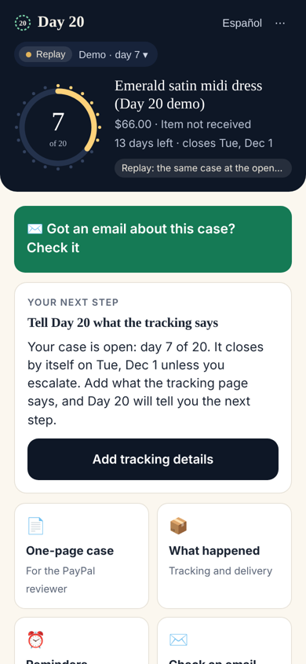
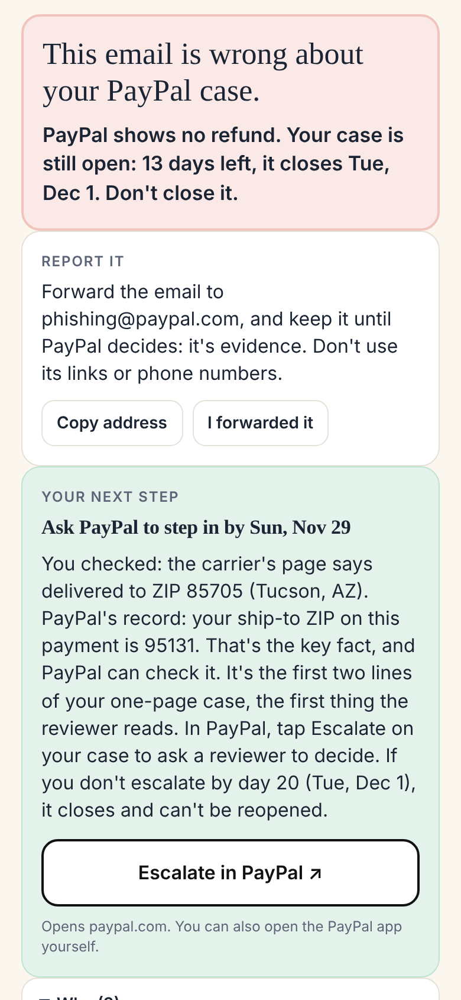
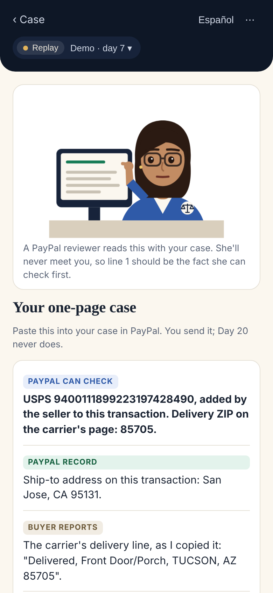
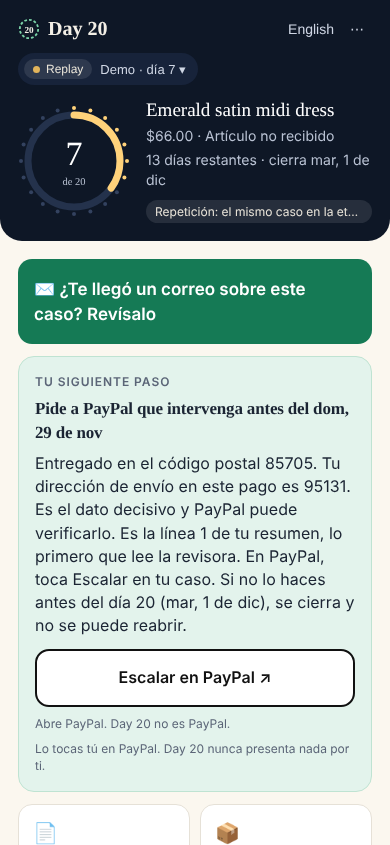

# Day 20

**Emails can lie. Your PayPal case can't.**

Day 20 is a read-only assistant for PayPal buyers with an open dispute. It reads the buyer's real case record from PayPal, checks any email about the case against that record, tells her the next step and the real deadline, and drafts a one-page case for the PayPal reviewer. Filing, escalating and closing stay with her, in PayPal.

<p>




</p>

> **Try it:** open **https://day20.onrender.com**, tap **Try it as Maya**, then **Got an email about this case? Check it** → **Use Maya's 3:14 a.m. email** → **Check it against my case**. No sign-in needed. See [TESTING.md](docs/TESTING.md).

## The problem

Maya is an ICU nurse. She bought a $66 dress for her best friend's wedding, paid with PayPal for the protection, and it never came. The tracking says delivered, in Tucson, Arizona; she lives in San Jose. She opened a dispute.

Then, at 3:14 a.m. on a break, she gets an email from `service@paypal.com`: *"The seller has issued a full refund of $66.00. Your case has been resolved. No further action is required."*

It isn't true. If she believes it and stops watching, then under PayPal's current rules her case closes by itself after 20 days unless she escalates, and a closed case can't be reopened. Ghost stores send emails like this because tired, honest buyers give up. Security researchers have reported scams delivered from PayPal's own genuine `service@paypal.com` address, by abusing PayPal features (e.g. Malwarebytes, 2025–2026).

In our 24-scene simulated dispute game, honest buyers mostly lost **before** review, to the clock and to traps, not **at** review.

## What Day 20 does

| | |
|---|---|
| **Reads her case** (read-only) | Status, refund, amount, dates, ship-to ZIP, and the tracking on file, from PayPal's APIs |
| **Checks an email against it** | Refund claimed vs refund on file, "case closed" vs status, reshipment numbers vs tracking on file, lookalike links, requests for codes, stalling ("no need to escalate"). The sender is never treated as proof. |
| **Tells her the next step** | Including **"not yet"** when an honest seller deserves time, and **"not covered"** when Buyer Protection doesn't apply. It never helps a false claim. |
| **Keeps the deadline** | Day 15 and day 18 reminders she chooses, by web push, email or calendar. Silent by default. |
| **Drafts the one-page case** | The deciding fact first. Every line is tagged `PAYPAL RECORD`, `PAYPAL CAN CHECK` or `BUYER REPORTS`, so the reviewer knows what to verify. |

**What it never does:** file, escalate, close or accept anything; message the seller; ask for a password or code; send sign-in links. The app, the agent and the MCP server only read from PayPal; the only writes are in the sandbox setup script, which plays the seller to build the demo case.

## Why PayPal would want this

Day 20 isn't a "file more claims" button. In our 24 test scenes it tells the buyer to escalate in 10 and to tell PayPal what actually arrived in 6. In the other 8 it says **don't escalate yet, or don't escalate at all**: the seller is answering and tracking is only stalled, she should check with a neighbour first, the item arrived as described, or the purchase isn't covered. Honest sellers keep their sales, and PayPal's reviewers get fewer weak claims. The claims that do arrive come with a one-page case where the deciding fact is on line 1 and tagged with what PayPal can check, so a reviewer can decide in minutes. And buyers stop losing protection they paid for because a fake email told them to wait out the 20 days.

## How it works

```
 Maya ── pastes email / screenshot ─┐
                                     ▼
                      ┌──────────────────────────┐   read-only    ┌──────────────────────┐
                      │  Agent loop (Claude)     │──────tools────▶│ PayPal sandbox APIs  │
                      │  read_case  read_claim   │                │ Disputes · Orders ·  │
                      │  compare    next_step    │◀───────────────│ Captures · Tracking  │
                      │  draft_page schedule_rem.│                └──────────────────────┘
                      └────────────┬─────────────┘
                                   ▼
            verdict + bottom line ◀── computed by code from PayPal's record, never by the model
            what Maya reads       ◀── sentences written by code; the model only picks which ones
            one-page case         ◀── built by code; buyer text sanitised and tagged as hers
```

- **The model reads; code decides and speaks.** Claude reads messy emails and screenshots (`read_claim`). Code computes the verdict (`mismatch` / `careful` / `consistent`), the bottom line, the next step and the one-page case from PayPal's record. The model then **picks** 2–4 sentences, written by code, for Maya to see (`compose_note`). It can't write its own.
- **The model can't remove a warning.** Its claims are OR-merged with the rule reader's, so it can add a flag but never remove one. Any email is at least "careful": Day 20 calls an email "consistent" only when a refund or closed claim it read agrees with PayPal's record.
- **Screenshots are transcribed first** by a call with no tools, so the rule reader sees every word the model sees.
- **No model, still an answer.** With no API key, or with the model down, the rule reader produces the verdict and default sentences on its own.

### PayPal APIs used

| Call | Why |
|---|---|
| `POST /v1/oauth2/token` | Client-credentials token (read-only use) |
| `GET /v1/customer/disputes`, `GET /v1/customer/disputes/{id}` | The case: status, reason, amount, outcome, dates |
| `GET /v2/payments/captures/{id}` → `GET /v2/checkout/orders/{id}` | Ship-to address and trackers, for the delivery-ZIP check |
| `GET /v1/shipping/trackers?transaction_id=` | Tracking numbers the seller added |
| Log in with PayPal (`/signin/authorize`, `/v1/identity/oauth2/userinfo`) | Identity: her payer ID, used to find her cases in the sandbox demo |
| Sandbox setup only: `POST /v2/checkout/orders`, `/capture`, `/track` | Builds Maya's real sandbox case ([`scripts/demo.js`](scripts/demo.js)) |

All of these are in the [Postman collection](postman/Day20.postman_collection.json).

## Who tests the AI?

We tested it by playing games. Agents attacked Day 20 for points, with evidence required ([docs/GAMES.md](docs/GAMES.md)).

- **Scammers** scored a point for every fake email the checker rated safe. In round one, 7 of 12 got through, so a real case number stopped counting as proof.
- **A cheat** forged a "PAYPAL CAN CHECK" line with a newline. Buyer text is now sanitized.
- **A rule-breaker** showed that regexes can't police what a language model means: 0 of 33 new harmful sentences were caught. **So we closed the model's output space.** It now picks sentences written by code instead of writing its own.
- **A blind PayPal reviewer** shaped the one-page case.
- **Honest senders** scored a point for genuine emails that Day 20 flagged red. In round one, all 12 were flagged, because a checker that cries wolf makes Maya report honest sellers. We rewrote the reader to work sentence by sentence.
- **An AI-assurance judge** caught us reporting fixed-against attacks as pass rates. We now split the numbers.

`npm run eval` reports where each case came from, because a pass rate on cases we fixed against isn't evidence:

| Group | What it is | Result |
|---|---|---|
| Designed | 24 dispute scenes plus test emails, written with the code | all pass |
| Regression | 24 scam emails and 36 genuine emails from the games, fixed against | every scam at least "careful" (9/24 red); every genuine email clean |
| **Held-out scams** | 12 game-4 emails, scored once before we tuned on them | **0/12 flagged red**; 12/12 never called safe (mostly by design) |
| **Held-out genuine emails** | fresh writers each round, scored before tuning | **clean: 0/12 → 5/12 → 11/12** over games 5–7 |

Every held-out set was then tuned on and moved to regression, so none is held out today. `npm run replay-heldout` re-scores each set with the commit it was first scored against and reproduces the numbers above ([RESULTS.md](tests/heldout/RESULTS.md)).

**Live model** (`npm run live-eval`, Claude on 36 test emails, Nov 11):
- 36 of 36 runs completed.
- The model's reading turned 2 "careful" results into red mismatches that the rules missed.
- 3 prompt-injection emails changed nothing.
- 0 sentences shown broke an honesty rule.
- Median time was 4.7 s.

**Live model on the deployed app** (all 24 scam and 36 genuine regression emails, Nov 11, [`deployed-2026-11-11.jsonl`](tests/live/deployed-2026-11-11.jsonl)):
- The model's reading raised scams flagged red from 9/24 (rules alone) to **11/24**.
- It also flagged **2 of 36 genuine emails** red that the rules called "careful": a seller's conditional offer ("if you accept, the refund of $20 would be sent") and a PayPal chat transcript ("no refund has been issued yet"). The model is allowed to add flags, and here it added wrong ones.
- 0 sentences shown broke an honesty rule. Median time 5.3 s.
- The API credit ran out at email 56. The last 5 fell back to rules on their own and still got an answer: that's the fallback working in production.
- **What we changed:** a model flag that can turn an email red (refund, closed case, close request, code request, off-PayPal payment) now needs the exact sentence quoted from the email. Code checks the quote is really there and is a plain statement up to the end of the quote: not negated, not conditional, not an offer. Replayed on the four sentences behind the live results, it keeps both catches and drops both false alarms. We tuned this on those two emails, so it's a fix, not evidence; it needs a fresh live run.

Raw results: [`tests/live/`](tests/live/).

Our honest reading: the safe default holds, and false alarms fell sharply once the reader went sentence by sentence. The keyword reader still misses reworded lies, and catching those is the model's job. `npm run live-eval` measures it with a real key. We couldn't run a fresh scam-writing round after game 4: the agent declined, stopped by a safety check, and we didn't work around it.

```
npm test        # unit + integration: RFC 8291 vector, model can't speak or act, model-down fallback, Spanish, server (push allowlist, forged cookies), time zones, MCP smoke test
npm run eval    # one line per case, with totals per group
npm run replay-heldout  # re-score each held-out set with the commit it was first scored against
```

## Run it

Node 22.13+, no dependencies.

```bash
npm run replay                 # offline, with a saved copy of a real sandbox case
cp .env.example .env           # then fill in sandbox keys
npm run live-check             # proves every PayPal call against the sandbox
npm run dev                    # http://localhost:3000
```

[](https://render.com/deploy?repo=https://github.com/dalyathan/day20)

The button uses [`render.yaml`](render.yaml) (Render Blueprint): one web service with a small disk for SQLite, and `/healthz` checks the database. With no keys it runs in replay mode on the saved sandbox case. Enter secrets in Render's form, never in the repo.

**Postman:** import `postman/Day20.postman_collection.json` and the environment next to it. Run request 1, then folder 3: each request saves the next ID (dispute → capture → order) and checks the response.

**MCP server** (the same read-only tools for any AI assistant):

```bash
claude mcp add day20 -- node /path/to/day20/mcp/server.js
```

Tools: `day20_read_case`, `day20_check_email`, `day20_next_step`, `day20_draft_page`, `day20_reminders`.

## What we'd ask PayPal for

1. **A buyer-side, read-only, per-case scope.** Log in with PayPal gives identity, not transactions. Today the sandbox demo reads the case through the demo seller account, because we own both test accounts.
2. **A delivered-ZIP vs ship-to-ZIP check** before funds are released on "delivered" tracking.
3. **A verified-agent lane:** an agent identity on what the reviewer sees, with a kill switch the buyer controls.

## Limits

- The demo opens a labelled **replay** of Maya's real sandbox case, shown at the open stage with the demo clock at day 7. (The real sandbox case went to PayPal review minutes after it was opened, so it can't show the open stage live.) Switch the demo chip to "Live sandbox case" to see the real, current case read from PayPal.
- "Delivered to ZIP 85705" is the buyer's reading of the carrier page. It's tagged so the reviewer looks it up.
- The email checker reads keywords. Paraphrased lies get a generic "careful" warning, not a red contradiction (see the held-out result).
- The live model path is tested with `npm run live-eval`, which needs a real key. The offline suite mocks it.

[Privacy and threat model](docs/PRIVACY_AND_THREATS.md) · MIT licensed · Not affiliated with or endorsed by PayPal. Not legal or financial advice. PayPal decides every case.
